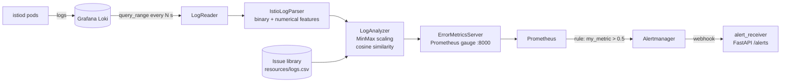
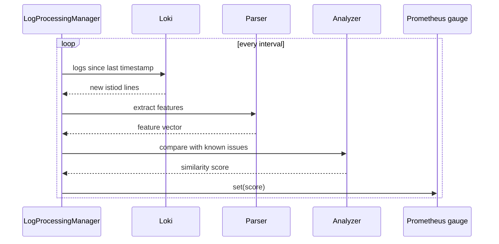

# LogsIstiodAnalysis — anomaly detection for Istio control-plane logs

A prototype that watches **istiod** (Istio control plane) logs in near real time and recognises known failure patterns. Logs are turned into feature vectors, compared with a library of previously diagnosed incidents, and the similarity score is exported to Prometheus so that Alertmanager can raise an alert before users notice the problem.

## How it works





1. **LogReader** polls Loki (`query_range`) every few seconds for new istiod log lines.
2. **IstioLogParser** extracts two kinds of features from each window of logs:
   - **binary** — presence of known error signatures (context cancellations, `ERROR` level, unavailable services, configuration and authentication errors, connection timeouts, proxy sync issues, network failures, TLS errors and more);
   - **numerical** — xDS push statistics: CDS clusters and services, EDS clusters / endpoints / empty endpoints, LDS listeners, etc.
3. **LogAnalyzer** scales the vector (MinMax) and compares it with the **issue library** (`resources/logs.csv`) using cosine similarity.
4. **ErrorMetricsServer** publishes the score as a Prometheus gauge; an alert rule fires when it exceeds the threshold.

## Project structure

```
src/                  — the analyser: reader, parser, features, analyzer, metrics server, manager
resources/logs.csv    — library of known-issue feature vectors
resources/model_config.yml
prometheus_adapter/   — Prometheus + Alertmanager compose, alert rules, FastAPI alert receiver
victoria_adapter/     — scripts to push sample logs into Loki and read them back
postgres_adapter/     — FastAPI service and scripts for storing diagnosed issues in PostgreSQL
Dockerfile
```

## Getting started

```bash
python -m venv venv && source venv/bin/activate
pip install -r requirements.txt

# 1. start Loki and load sample logs
docker run -d -p 3100:3100 grafana/loki:latest
python victoria_adapter/data_creator.py        # reads logs/istiod-discovery.log

# 2. start Prometheus + Alertmanager
cd prometheus_adapter && docker compose up -d && cd ..

# 3. run the analyser (metrics on :8000)
cd src && python main.py
```

Or in Docker:

```bash
docker build -t istiod-log-analyzer .
docker run -p 8000:8000 istiod-log-analyzer
```

Log samples are not included in the repository — point `victoria_adapter/data_creator.py` at your own istiod logs.

## Stack

Python, pandas, NumPy, scikit-learn, FastAPI, prometheus_client, Prometheus, Alertmanager, Grafana Loki, PostgreSQL (asyncpg).
